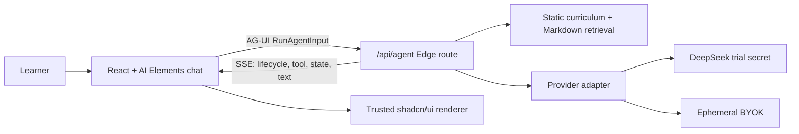

# Conversational academy architecture

Status: local MVP architecture, not a production rollout record.

## Product loop

The learner asks how the application works. The server retrieves a curriculum lesson and repository documents, emits an AG-UI state snapshot, and streams a grounded answer. The interface renders the answer, updates the active lesson artifact, and exposes a sanitized event trace. The learner can then inspect the same source files used to build the feature.

## Runtime

The required backend is one stateless streaming route. Course content remains version-controlled in GitHub. The browser persists only conversation text; API keys stay in React memory and disappear on refresh.

## Provider policy

- Trial calls are disabled unless both `TRIAL_ENABLED=true` and `DEEPSEEK_API_KEY` exist in the deployment environment.
- Without them, the same AG-UI event path returns a deterministic offline lesson.
- Preset BYOK providers use fixed HTTPS base URLs.
- Custom OpenAI-compatible hosts must appear in `CUSTOM_PROVIDER_HOSTS`; private/local addresses and non-HTTPS URLs are rejected.
- Public trial must not be enabled until real rate limiting, abuse monitoring, a budget ceiling, and a kill switch are in place.

## RAG path

Phase one uses deterministic token overlap over reviewed local content. It is cheap, inspectable, bilingual, and sufficient for a small corpus. Add Supabase only when evaluation demonstrates a semantic-recall or cross-device persistence need. A future Supabase design must use explicit Data API grants, RLS, owner-scoped rows, and separate public and service credentials.

## Extension paths

- json-render, OpenUI, or A2UI can replace selected lesson artifacts when runtime composition is required.
- MCP can expose curriculum resources and repository tools to the tutor.
- MCP-UI can embed isolated interactive labs.
- Supabase can add authenticated progress, conversations, feedback, hybrid retrieval, and trial quotas.
- ACP belongs in a future coding workspace that hands implementation tasks to coding agents; it is not the main learner-to-tutor transport.

These are extension paths, not claims about the current MVP.
